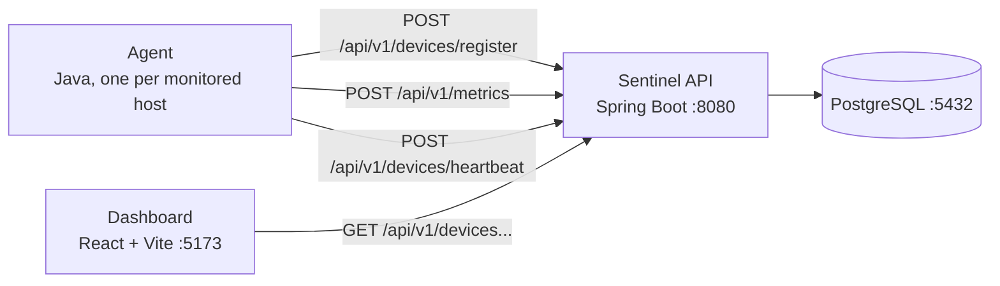

# Sentinel

Server monitoring made simple. A lightweight JVM agent collects CPU, memory,
disk, and network metrics from every monitored host; a Spring Boot API stores
and serves them; and a web dashboard shows device health and metric history in
real time.

> **Status:** early development (`0.1.0`). Device registration, heartbeats,
> metric collection, offline detection, and the dashboard are implemented and
> working. Authentication (JWT), alerting, and device audit history are planned
> but not built yet. See [docs/api-spec.md](docs/api-spec.md) for exactly what
> the API supports today.

## How it fits together



1. The **agent** registers itself once and then reports a metrics sample and a
   heartbeat on a fixed interval. If the API has not heard from a device for
   more than 90 seconds, a scheduled task flips it to `OFFLINE`.
2. The **API** stores devices and metric samples in PostgreSQL and serves them
   over a versioned HTTP API.
3. The **dashboard** polls the API and renders device cards with live
   ONLINE/OFFLINE status and per-device metric charts.

## Repository layout

| Path                      | Description                                             |
| ------------------------- | ------------------------------------------------------- |
| `agent/`                  | Standalone monitoring agent (Java, no framework)        |
| `backend/sentinel-api/`   | Spring Boot REST API                                     |
| `frontend/`               | React + TypeScript dashboard (Vite)                      |
| `docs/`                   | API spec, domain model, and design drafts                |
| `architecture/`           | Architecture decision records (ADRs)                     |
| `docker/`                 | Docker Compose file and PostgreSQL init script          |

## Prerequisites

- Java 21
- Maven 3.8+ (or use `./mvnw` inside `backend/sentinel-api`)
- Node.js 20+ and npm
- Docker (for the local PostgreSQL instance only)

## Run the stack locally

### 1. Database

The API requires PostgreSQL. The Compose file starts one with credentials
`sentinel` / `sentinel` on `localhost:5432`:

```bash
docker compose -f docker/docker-compose.yml up -d
```

### 2. Backend API

```bash
cd backend/sentinel-api
mvn spring-boot:run
```

The API listens on `http://localhost:8080`. Check the health and device
endpoints documented in [docs/api-spec.md](docs/api-spec.md):

```bash
curl http://localhost:8080/api/v1/devices
```

### 3. Agent

Run one agent per machine you want to monitor:

```bash
cd agent
mvn exec:java
```

The agent registers itself (identity is persisted at
`~/.sentinel-agent/agent-id`), then reports metrics and heartbeats every
30 seconds. It is configured with environment variables:

| Variable                   | Default                     | Description                       |
| -------------------------- | --------------------------- | --------------------------------- |
| `SENTINEL_API_URL`         | `http://localhost:8080`     | Base URL of the Sentinel API      |
| `SENTINEL_INTERVAL_SECONDS`| `30`                        | Seconds between metric/heartbeat  |

To print a single metrics snapshot in JSON and exit (no network calls), run:

```bash
mvn exec:java -Dexec.args="--print"
```

### 4. Dashboard

```bash
cd frontend
npm install
npm run dev
```

Open `http://localhost:5173`. The Vite dev server proxies `/api` to the API on
`:8080` (`frontend/vite.config.ts`), so no CORS configuration is needed. The
dashboard polls the device list every 10 seconds and, while a device is open,
its metrics every 5 seconds. See [frontend/README.md](frontend/README.md).

## Tests

```bash
# Backend: runs against an in-memory H2 database; no PostgreSQL needed.
cd backend/sentinel-api && mvn test

# Frontend
cd frontend && npm test && npm run lint
```

## Documentation

- [docs/api-spec.md](docs/api-spec.md) — the implemented HTTP API, verified
- [docs/domain-model.md](docs/domain-model.md) — entities and relationships
- [docs/product-vision.md](docs/product-vision.md) — product goals
- [docs/system-architecture.md](docs/system-architecture.md) — design draft
- [docs/tech-stack.md](docs/tech-stack.md) — technology choices
- [architecture/](architecture/) — architecture decision records

## License

This project is licensed under the MIT License.