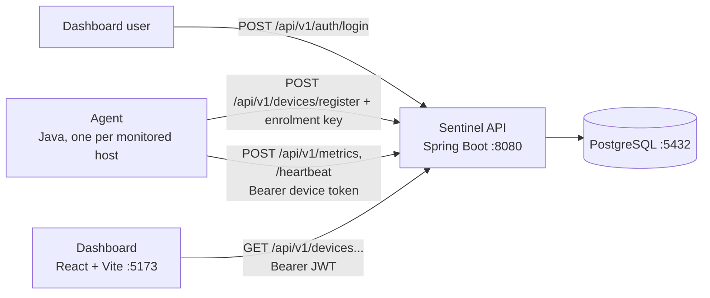

# Sentinel

Server monitoring made simple. A lightweight JVM agent collects CPU, memory,
disk, and network metrics from every monitored host; a Spring Boot API stores
and serves them; and a web dashboard shows device health and metric history in
real time.

> **Status:** early development (`0.1.0`). Device registration, heartbeats,
> metric collection, offline detection, the dashboard, and authentication
> (dashboard JWT plus per-device agent tokens) are implemented and working.
> Alerting and device audit history are planned but not built yet. See
> [docs/api-spec.md](docs/api-spec.md) for exactly what the API supports today
> and [docs/security.md](docs/security.md) for the authentication design.

## How it fits together



1. The **agent** registers itself once with a shared enrolment key, receives a
   per-device token, and then reports a metrics sample and a heartbeat on a
   fixed interval. If the API has not heard from a device for more than 90
   seconds, a scheduled task flips it to `OFFLINE`.
2. The **API** authenticates users with a JWT and agents with device tokens,
   stores devices and metric samples in PostgreSQL, and serves them over a
   versioned HTTP API.
3. The **dashboard** logs in to obtain a JWT, then polls the API and renders
   device cards with live ONLINE/OFFLINE status and per-device metric charts.

## Repository layout

| Path                      | Description                                             |
| ------------------------- | ------------------------------------------------------- |
| `agent/`                  | Standalone monitoring agent (Java, no framework)        |
| `backend/sentinel-api/`   | Spring Boot REST API                                     |
| `frontend/`               | React + TypeScript dashboard (Vite)                      |
| `docs/`                   | API spec, domain model, and design drafts                |
| `architecture/`           | Architecture decision records (ADRs)                     |
| `docker/`                 | Docker Compose file and PostgreSQL init script          |

## Prerequisites

- Java 21
- Maven 3.8+ (or use `./mvnw` inside `backend/sentinel-api`)
- Node.js 20+ and npm
- Docker (for the local PostgreSQL instance only)

## Run the stack locally

### 1. Database

The API requires PostgreSQL. The Compose file starts one with credentials
`sentinel` / `sentinel` on `localhost:5432`:

```bash
docker compose -f docker/docker-compose.yml up -d
```

### 2. Backend API

The API authenticates dashboard users, so it will not start without a signing
secret and an enrolment key. Generate values once and export them:

```bash
export SENTINEL_JWT_SECRET=$(openssl rand -base64 32)
export SENTINEL_ENROLLMENT_KEY=$(openssl rand -base64 32)
export SENTINEL_ADMIN_USERNAME=admin
export SENTINEL_ADMIN_PASSWORD='choose-a-strong-password'
```

| Variable | Required | Description |
| --- | --- | --- |
| `SENTINEL_JWT_SECRET` | yes | HS256 signing key, at least 32 bytes |
| `SENTINEL_ENROLLMENT_KEY` | yes | Shared key an agent presents on first registration, at least 24 characters |
| `SENTINEL_ADMIN_USERNAME` | no | Bootstrap admin username. Set together with the password. |
| `SENTINEL_ADMIN_PASSWORD` | no | Bootstrap admin password, at least 12 characters |
| `SENTINEL_JWT_TTL_SECONDS` | no | JWT lifetime in seconds (default `28800`, i.e. 8 hours) |

The admin account is only created when the API first starts against an empty
database and both admin variables are set. See
[docs/security.md](docs/security.md) for the full rules and the threat model.

Then start the API:

```bash
cd backend/sentinel-api && mvn spring-boot:run
```

The API listens on `http://localhost:8080`. The device endpoints now require a
JWT, which you can obtain from the login endpoint:

```bash
curl -X POST http://localhost:8080/api/v1/auth/login \
  -H 'Content-Type: application/json' \
  -d '{"username":"admin","password":"choose-a-strong-password"}'
```

### 3. Agent

Run one agent per machine you want to monitor. On its first run the agent needs
the enrolment key:

```bash
cd agent
export SENTINEL_ENROLLMENT_KEY='the-same-key-you-set-for-the-api'
mvn exec:java
```

The agent persists its identity at `~/.sentinel-agent/agent-id` and its device
token at `~/.sentinel-agent/device-token`, then reports metrics and heartbeats
every 30 seconds using that token. It is configured with environment variables:

| Variable                    | Default                     | Description                          |
| --------------------------- | --------------------------- | ------------------------------------ |
| `SENTINEL_API_URL`          | `http://localhost:8080`     | Base URL of the Sentinel API         |
| `SENTINEL_INTERVAL_SECONDS` | `30`                        | Seconds between metric/heartbeat     |
| `SENTINEL_ENROLLMENT_KEY`   | (none)                      | Required on first run; unused after a token is stored |

After the first run the token file is sufficient, so
`SENTINEL_ENROLLMENT_KEY` no longer needs to be set. If the token is revoked, an
authenticated dashboard user clicks "Revoke device token", and an operator then
deletes `~/.sentinel-agent/device-token` and restarts the agent to re-enrol.

To print a single metrics snapshot in JSON and exit (no key and no network
calls), run:

```bash
mvn exec:java -Dexec.args="--print"
```

### 4. Dashboard

```bash
cd frontend
npm install
npm run dev
```

Open `http://localhost:5173` and log in with the admin credentials. The Vite dev
server proxies `/api` to the API on `:8080` (`frontend/vite.config.ts`), so no
CORS configuration is needed. The dashboard polls the device list every 10
seconds and, while a device is open, its metrics every 5 seconds. The JWT is
kept in `sessionStorage`, so it is cleared when the tab closes. See
[frontend/README.md](frontend/README.md).

## Tests

```bash
# Backend: runs against an in-memory H2 database; no PostgreSQL needed.
cd backend/sentinel-api && mvn test

# Agent
cd agent && mvn test

# Frontend
cd frontend && npm test && npm run lint
```

## Documentation

- [docs/api-spec.md](docs/api-spec.md) — the implemented HTTP API, verified
- [docs/security.md](docs/security.md): authentication, tokens, and threat model
- [docs/domain-model.md](docs/domain-model.md) — entities and relationships
- [docs/product-vision.md](docs/product-vision.md) — product goals
- [docs/system-architecture.md](docs/system-architecture.md) — design draft
- [docs/tech-stack.md](docs/tech-stack.md) — technology choices
- [architecture/](architecture/) — architecture decision records

## License

This project is licensed under the MIT License.