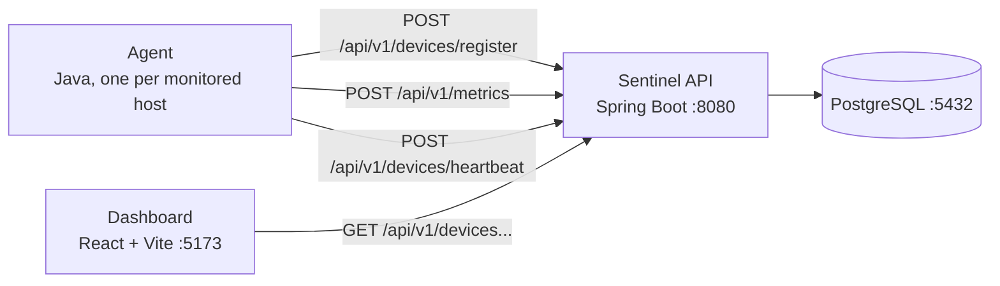

# Sentinel

Server monitoring made simple. A lightweight JVM agent collects CPU, memory,
disk, and network metrics from every monitored host; a Spring Boot API stores
and serves them; and a web dashboard shows device health and metric history in
real time.

> **Status:** early development (`0.1.0`). Device registration, heartbeats,
> metric collection, offline detection, and the dashboard are implemented and
> working. Authentication, alerting, and device audit history are planned but
> not built yet. See [docs/api-spec.md](docs/api-spec.md) for exactly what the
> API supports today.

## How it fits together



1. The **agent** registers itself once and then reports a metrics sample and a
   heartbeat on a fixed interval. If the API has not heard from a device for
   more than 90 seconds, a scheduled task flips it to `OFFLINE`.
2. The **API** stores devices and metric samples in PostgreSQL and serves them
   over a versioned HTTP API.
3. The **dashboard** polls the API and renders device cards with live
   ONLINE/OFFLINE status and per-device metric charts.

## Repository layout

| Path                      | Description                                             |
| ------------------------- | ------------------------------------------------------- |
| `agent/`                  | Standalone monitoring agent (Java, no framework)        |
| `backend/sentinel-api/`   | Spring Boot REST API                                     |
| `frontend/`               | React + TypeScript dashboard (Vite)                      |
| `docs/`                   | API spec, domain model, and design drafts                |
| `architecture/`           | Architecture decision records (ADRs)                     |
| `docker/`                 | Docker Compose file and PostgreSQL init script          |

## Prerequisites

- Java 21
- Maven 3.6 or newer (or use `./mvnw` inside `backend/sentinel-api`)
- Node.js 20+ and npm
- Docker (for the local PostgreSQL instance only)

## Configuration

The agent is configured with environment variables and the API with
`backend/sentinel-api/src/main/resources/application.properties`. The defaults
below come from `AgentMain.java`, that properties file, and
`frontend/vite.config.ts`.

| Setting | Default | Where |
| --- | --- | --- |
| `SENTINEL_API_URL` | `http://localhost:8080` | `agent/src/main/java/com/remi481/sentinel/agent/AgentMain.java` |
| `SENTINEL_INTERVAL_SECONDS` | `30` | `AgentMain.java` |
| `spring.datasource.url` | `jdbc:postgresql://localhost:5432/sentinel` | `application.properties` |
| `spring.datasource.username` | `sentinel` | `application.properties` |
| `spring.datasource.password` | `sentinel` | `application.properties` |
| `server.port` | `8080` | `application.properties` |
| `sentinel.offline.threshold-seconds` | `90` | `application.properties` |
| `sentinel.offline.check-interval-ms` | `30000` | `application.properties` |
| Vite proxy for `/api` | `http://localhost:8080` | `frontend/vite.config.ts` |

An agent environment variable can also be set inline when you start it.

bash:

```bash
SENTINEL_INTERVAL_SECONDS=5 mvn exec:java
```

PowerShell:

```powershell
$env:SENTINEL_INTERVAL_SECONDS="5"; mvn exec:java
```

## Run the stack locally

All paths below use forward slashes, which work in both bash and PowerShell.
Where a command has to be different, the bash and PowerShell versions are shown
side by side.

### 1. Database

The API requires PostgreSQL. The Compose file starts one with credentials
`sentinel` / `sentinel` on `localhost:5432`:

```bash
docker compose -f docker/docker-compose.yml up -d
```

### 2. Backend API

```bash
cd backend/sentinel-api
mvn spring-boot:run
```

The API listens on `http://localhost:8080`. Confirm it is up by calling the
devices endpoint documented in [docs/api-spec.md](docs/api-spec.md), which
returns the registered devices as JSON.

bash:

```bash
curl http://localhost:8080/api/v1/devices
```

PowerShell uses `curl.exe` (plain `curl` is an alias for `Invoke-WebRequest`):

```powershell
curl.exe http://localhost:8080/api/v1/devices
```

### 3. Agent

Run one agent per machine you want to monitor:

```bash
cd agent
mvn exec:java
```

The agent registers itself (identity is persisted at
`~/.sentinel-agent/agent-id`), then reports metrics and heartbeats every 30
seconds by default (see Configuration for the environment variables).

To print a single metrics snapshot in the form
`MetricsSnapshot[cpuUsagePercent=..., ...]` and exit without contacting the
API, use `--print`. (The output is the Java record's `toString()`, not JSON.)

bash:

```bash
mvn exec:java "-Dexec.args=--print"
```

PowerShell:

```powershell
mvn exec:java '-Dexec.args=--print'
```

Example output, values differ between machines and runs:

```text
MetricsSnapshot[cpuUsagePercent=16.1, memoryUsedBytes=3104018432, memoryTotalBytes=7898542080, diskUsedBytes=73822474240, diskTotalBytes=1081101176832, uptimeSeconds=20297, networkReceivedBytesPerSecond=10109, networkSentBytesPerSecond=1250]
```

### 4. Dashboard

```bash
cd frontend
npm install
npm run dev
```

Open `http://localhost:5173`. The Vite dev server proxies `/api` to the API on
`:8080` (`frontend/vite.config.ts`), so no CORS configuration is needed. The
dashboard polls the device list every 10 seconds and, while a device is open,
its metrics every 5 seconds. See [frontend/README.md](frontend/README.md).

## Tests

The backend tests run against an in-memory H2 database, so no PostgreSQL is
needed. Each line uses the current directory, so the commands work in both bash
and PowerShell.

```
cd backend/sentinel-api
mvn test
```

Frontend tests and linter:

```
cd frontend
npm test
npm run lint
```

## Current limits

- There is no authentication yet. Anyone who can reach the API can read the
  device list and post metrics and heartbeats.
- `GET /api/v1/health` returns `403 Forbidden`. It is not open to unauthenticated
  callers and no login mechanism is configured yet. Use
  `GET /api/v1/devices` to check that the API is up.
- Metric history is capped at 100 readings per device, newest first.
- Uptime and network rates come from `/proc` on Linux; on Windows the agent
  shells out to PowerShell, so on a restricted Windows machine those fields can
  come back null.
- The project is not ready for the public internet.

## Roadmap

- Authentication for dashboard users and agents.
- Deployment to AWS.
- Continuous integration.
- Alerts.

## Documentation

- [docs/api-spec.md](docs/api-spec.md): the implemented HTTP API, verified
- [docs/domain-model.md](docs/domain-model.md): entities and relationships
- [docs/product-vision.md](docs/product-vision.md): product goals
- [docs/system-architecture.md](docs/system-architecture.md): design draft
- [docs/tech-stack.md](docs/tech-stack.md): technology choices
- [architecture/](architecture/): architecture decision records

## License

This project is licensed under the MIT License.