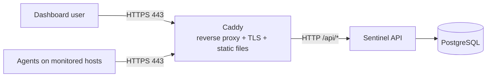

# Deploying Sentinel

Sentinel runs as a small Docker Compose stack on a single Linux server. There is
no cloud dependency: the server only needs Docker and a DNS name (or IP address)
that clients can reach.

## What runs where



| Service | Image / build | Published | Role |
| --- | --- | --- | --- |
| `web` | `deploy/web.Dockerfile` (Caddy) | `80`, `443` | Terminates TLS, serves the dashboard, proxies `/api/*` to the API |
| `api` | `backend/sentinel-api/Dockerfile` | internal only | Spring Boot API, `prod` profile |
| `db` | `postgres:17` | internal only | PostgreSQL with a persistent volume |
| `agent` | `agent/Dockerfile` (optional) | internal only | One monitoring agent, starts only with the `agent` profile |

The API and database have no published ports; only Caddy is reachable from
outside. The dashboard calls the API through relative `/api/...` URLs on the same
origin, so there is no CORS configuration.

## Prerequisites

- A Linux server with Docker Engine and the Compose plugin.
- Ports `80` and `443` open in the firewall (Caddy needs `80` for the ACME
  challenge and `443` for HTTPS).
- A DNS `A` record pointing your domain at the server. For a trial without a
  domain or TLS, you can use `http://localhost` and reach the stack on port `80`.

## Quick start

```bash
git clone <repository-url> sentinel
cd sentinel/deploy

# Create .env with strong random secrets.
./scripts/generate-secrets.sh

# Edit .env and set at least SENTINEL_DOMAIN and SENTINEL_ADMIN_USERNAME.
$EDITOR .env

docker compose up -d --build
```

Then open your domain in a browser and log in with
`SENTINEL_ADMIN_USERNAME` and `SENTINEL_ADMIN_PASSWORD`. The admin account is
created the first time the API starts against an empty database.

Check that everything came up:

```bash
docker compose ps
curl -fsS https://your-domain/api/v1/health    # {"status":"UP"}
```

## Configuration

All configuration lives in `deploy/.env` (started from `.env.example`). Compose
fails to start if a required value is missing, and the API refuses to boot if any
value is too weak, so misconfiguration surfaces immediately.

| Variable | Required | Notes |
| --- | --- | --- |
| `SENTINEL_DOMAIN` | yes | DNS name Caddy serves. Use `http://localhost` to run without TLS. |
| `SENTINEL_DB_PASSWORD` | yes | Password for the bundled PostgreSQL. |
| `SENTINEL_JWT_SECRET` | yes | Dashboard JWT signing key, at least 32 bytes. |
| `SENTINEL_ENROLLMENT_KEY` | yes | Shared agent enrolment key, at least 24 characters. |
| `SENTINEL_ADMIN_USERNAME` | yes | Bootstrap admin username. |
| `SENTINEL_ADMIN_PASSWORD` | yes | Bootstrap admin password, at least 12 characters. |
| `SENTINEL_INTERVAL_SECONDS` | no | Agent sample interval (default `30`). |

`SENTINEL_DB_PASSWORD`, `SENTINEL_JWT_SECRET`, `SENTINEL_ENROLLMENT_KEY`, and
`SENTINEL_ADMIN_PASSWORD` are generated by `scripts/generate-secrets.sh`. The
script never overwrites a value you have already set, so it is safe to re-run.

Never commit `deploy/.env`; it is already in `.gitignore`.

## TLS

Caddy obtains and renews a certificate for `SENTINEL_DOMAIN` automatically from
Let's Encrypt, and redirects HTTP to HTTPS. Certificate state is kept in the
`caddy-data` volume, so it survives container restarts. If the domain is not
resolvable or port `80` is blocked, certificate issuance fails and Caddy logs the
reason:

```bash
docker compose logs web
```

## Running an agent

Install the agent on each host you want to monitor. The agent is a plain Java
program and needs Java 21:

```bash
cd agent
SENTINEL_API_URL=https://your-domain \
SENTINEL_ENROLLMENT_KEY='the-enrolment-key-from-.env' \
  mvn exec:java
```

On its first run it enrols with the enrolment key, stores its identity and device
token under `~/.sentinel-agent/`, and then reports metrics and heartbeats every
30 seconds. After that the enrolment key is not needed again.

You can also run an agent in a container (useful to try the stack, since the
agent then monitors its own container). The identity is kept in the `agent-data`
volume so the container does not re-enrol on restart:

```bash
docker compose --profile agent up -d --build
```

## Backups and restore

`scripts/backup.sh` runs `pg_dump` in the database container and writes a gzipped
dump to `deploy/backups/`, deleting dumps older than seven days. Run it from cron:

```bash
# Every day at 03:00
0 3 * * * /path/to/sentinel/deploy/scripts/backup.sh >> /var/log/sentinel-backup.log 2>&1
```

Restore a dump into a running stack:

```bash
gunzip -c deploy/backups/sentinel-YYYYmmddTHHMMSSZ.sql.gz \
  | docker compose exec -T db sh -c 'psql -U "$POSTGRES_USER" -d "$POSTGRES_DB"'
```

Override the output directory and retention with `SENTINEL_BACKUP_DIR` and
`SENTINEL_BACKUP_RETENTION_DAYS`.

## Updating and rolling back

```bash
cd deploy
git pull
docker compose up -d --build
```

Compose recreates only the services whose image changed. The API handles
`SIGTERM` gracefully and finishes in-flight requests before stopping. Database
schema changes are applied by Hibernate on startup (`ddl-auto=update`).

To roll back, check out the previous commit and run `docker compose up -d --build`
again. The database volume is left untouched across rebuilds.

## Logs and troubleshooting

```bash
docker compose logs -f            # all services
docker compose logs -f api        # API only
docker compose ps                 # container and health status
docker compose exec db pg_isready -U sentinel
```

- **API container is unhealthy.** The healthcheck calls `/api/v1/health`, which
  returns `503` when the database is unreachable. Check `docker compose logs api`
  and confirm the database is up.
- **API exits immediately on start.** Startup validation prints every
  configuration problem in one message. Fix the values in `.env` and restart.
- **Certificate not issued.** Confirm `SENTINEL_DOMAIN` resolves to the server
  and that port `80` is reachable.
- **Agent stays `OFFLINE`.** Confirm the agent can reach `SENTINEL_API_URL` and
  that `SENTINEL_ENROLLMENT_KEY` matches the API's value.
