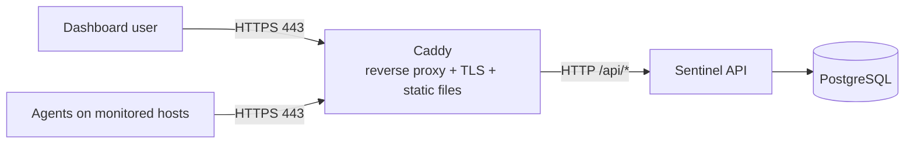

# Deploying Sentinel

Sentinel runs as a small Docker Compose stack on a single Linux server. There is
no cloud dependency: the server only needs Docker and a DNS name (or IP address)
that clients can reach.

## What runs where



| Service | Image / build | Published | Role |
| --- | --- | --- | --- |
| `web` | `deploy/web.Dockerfile` (Caddy) | `80`, `443` | Terminates TLS, serves the dashboard, proxies `/api/*` to the API |
| `api` | `backend/sentinel-api/Dockerfile` | internal only | Spring Boot API, `prod` profile |
| `db` | `postgres:17` | internal only | PostgreSQL with a persistent volume |
| `agent` | `agent/Dockerfile` (optional) | internal only | One monitoring agent, starts only with the `agent` profile |

The API and database have no published ports; only Caddy is reachable from
outside. The dashboard calls the API through relative `/api/...` URLs on the same
origin, so there is no CORS configuration.

## Prerequisites

- A Linux server with Docker Engine and the Compose plugin.
- Ports `80` and `443` open in the firewall (Caddy needs `80` for the ACME
  challenge and `443` for HTTPS).
- A DNS `A` record pointing your domain at the server. For a trial without a
  domain or TLS, you can use `http://localhost` and reach the stack on port `80`.

## Quick start

Linux/macOS (bash):

```bash
git clone <repository-url> sentinel
cd sentinel/deploy

# Create .env from .env.example with fresh random secrets.
# The script asks for the bootstrap admin password on a hidden prompt and
# leaves SENTINEL_DOMAIN at its localhost default for a local trial.
./scripts/generate-secrets.sh --write

docker compose up -d --build
```

Windows (PowerShell, no WSL needed):

```powershell
git clone <repository-url> sentinel
cd sentinel\deploy

# Create .env from .env.example with fresh random secrets.
# The script asks for the bootstrap admin password on a hidden prompt and
# leaves SENTINEL_DOMAIN at its localhost default for a local trial.
powershell -ExecutionPolicy Bypass -File .\scripts\generate-secrets.ps1 -Write

docker compose up -d --build
```

For a local trial the address to open is `https://localhost`. Do not use
`127.0.0.1` or an IP address: the certificate only covers the name
`SENTINEL_DOMAIN`, so any other name shows a certificate error. On a real
server, set `SENTINEL_DOMAIN` to the server's DNS name before starting the
stack.

In `.env` every line is `NAME=value`, with no spaces around the `=` and no quotes
around the value. The write mode replaces `SENTINEL_DB_PASSWORD`,
`SENTINEL_JWT_SECRET` and `SENTINEL_ENROLLMENT_KEY` in place without showing
them, takes `SENTINEL_ADMIN_PASSWORD` from the hidden prompt, sets an empty or
placeholder `SENTINEL_DOMAIN` to `localhost`, and sets `SENTINEL_ADMIN_USERNAME`
to `admin` unless it already has a value. A real DNS name in `SENTINEL_DOMAIN`
is never overwritten. The `-ExecutionPolicy Bypass` flag is only needed if your
execution policy blocks the script.

The write mode never prints the values it writes, and it refuses to overwrite
values that are already real unless you pass `--force` (`-Force` on Windows), so
it is safe to run again.

PostgreSQL only reads `SENTINEL_DB_PASSWORD` when the database volume is first
created, so changing it later in `.env` does not change the password inside an
existing volume. For a trial, `docker compose down -v` throws the volume away so
the new password takes effect.

To paste the values in by hand instead, run the script without `--write` or
`-Write`. That print-only mode shows one `NAME=value` line per secret and touches
no file:

```bash
./scripts/generate-secrets.sh
```

```powershell
powershell -ExecutionPolicy Bypass -File .\scripts\generate-secrets.ps1
```

Save every printed value in a password manager, because the enrolment key is
needed again every time you enrol a new agent.

Then open your domain in a browser and log in with
`SENTINEL_ADMIN_USERNAME` and `SENTINEL_ADMIN_PASSWORD`. The admin account is
created the first time the API starts against an empty database.

Check that everything came up:

```bash
docker compose ps
curl -fsS https://your-domain/api/v1/health    # {"status":"UP"}
```

## Configuration

All configuration lives in `deploy/.env` (started from `.env.example`). Compose
fails to start if a required value is missing, and the API refuses to boot if any
value is too weak or still the `REPLACE_WITH_GENERATED_VALUE` placeholder from
`.env.example`, so misconfiguration surfaces immediately.

| Variable | Required | Notes |
| --- | --- | --- |
| `SENTINEL_DOMAIN` | yes | Name Caddy serves and gets a certificate for. `.env.example` defaults to `localhost` for a local trial; set your server's DNS name for production. |
| `SENTINEL_DB_PASSWORD` | yes | Password for the bundled PostgreSQL, at least 16 characters. |
| `SENTINEL_JWT_SECRET` | yes | Dashboard JWT signing key, at least 32 bytes. |
| `SENTINEL_ENROLLMENT_KEY` | yes | Shared agent enrolment key, at least 24 characters. |
| `SENTINEL_ADMIN_USERNAME` | yes | Bootstrap admin username. |
| `SENTINEL_ADMIN_PASSWORD` | yes | Bootstrap admin password, at least 12 characters. |
| `SENTINEL_INTERVAL_SECONDS` | no | Agent sample interval (default `30`). |

`SENTINEL_DB_PASSWORD`, `SENTINEL_JWT_SECRET`, `SENTINEL_ENROLLMENT_KEY`, and
`SENTINEL_ADMIN_PASSWORD` are filled in by `scripts/generate-secrets.sh --write`
(or `scripts\generate-secrets.ps1 -Write` on Windows), which prints no values.
Re-running it refuses to overwrite values that are already real; pass `--force`
(`-Force`) to replace them on purpose.

Never commit `deploy/.env`; it is already in `.gitignore`.

## TLS

Caddy obtains and renews a certificate for `SENTINEL_DOMAIN` automatically from
Let's Encrypt, and redirects HTTP to HTTPS. Certificate state is kept in the
`caddy-data` volume, so it survives container restarts. If the domain is not
resolvable or port `80` is blocked, certificate issuance fails and Caddy logs the
reason:

```bash
docker compose logs web
```

For a local trial `SENTINEL_DOMAIN` is already `localhost`, so Caddy issues a
certificate from its own internal CA and serves `https://localhost`. Open
`https://localhost`, not `127.0.0.1` or an IP address; the certificate only
covers the name `localhost`, so anything else shows a certificate error.
Browsers do not trust that CA, so use `curl -k` or accept the warning; this mode
is for testing, not for production.

## Running an agent

Install the agent on each host you want to monitor. The agent is a plain Java
program and needs Java 21:

```bash
cd agent
SENTINEL_API_URL=https://your-domain \
SENTINEL_ENROLLMENT_KEY='the-enrolment-key-from-.env' \
  mvn exec:java
```

On its first run it enrols with the enrolment key, stores its identity and device
token under `~/.sentinel-agent/`, and then reports metrics and heartbeats every
30 seconds. After that the enrolment key is not needed again.

You can also run an agent in a container (useful to try the stack, since the
agent then monitors its own container). The identity is kept in the `agent-data`
volume so the container does not re-enrol on restart:

```bash
docker compose --profile agent up -d --build
```

For a local trial (`SENTINEL_DOMAIN=localhost`) run the agent in a container as
above rather than with `mvn exec:java`. Caddy serves `https://localhost` with its
own internal CA, which the JVM does not trust, so a host agent's TLS handshake
fails. The container agent talks to the API over the Compose network and is not
affected.

## Verify the deployment

`scripts/check-forged-headers.sh` (and its PowerShell twin
`scripts/check-forged-headers.ps1`) is a regression check for the login throttle.
Caddy is the only ingress and the API trusts the proxy, so it derives the client
IP from the `X-Forwarded-For` / `Forwarded` headers. The check sends 25 wrong
logins, each with a different forged forwarding header, and requires the
per-address limit to stop the flood. If a forged header changed the throttle key
the check fails, so run it after `docker compose up -d`:

```bash
# Linux/macOS, or Git Bash/WSL on Windows
deploy/scripts/check-forged-headers.sh
SENTINEL_BASE_URL=https://your-domain deploy/scripts/check-forged-headers.sh
```

```powershell
# Windows PowerShell
cd deploy
.\scripts\check-forged-headers.ps1
.\scripts\check-forged-headers.ps1 -BaseUrl https://your-domain
```

The shell script reads `SENTINEL_BASE_URL`, `SENTINEL_LIMIT`, `SENTINEL_REQUESTS`
and `SENTINEL_INSECURE` from the environment; the PowerShell script takes the
equivalent `-BaseUrl`, `-Limit` and `-Requests` parameters.

## Backups and restore

`scripts/backup.sh` runs `pg_dump` in the database container and writes a gzipped
dump to `deploy/backups/`, deleting dumps older than seven days. Run it from cron:

```bash
# Every day at 03:00
0 3 * * * /path/to/sentinel/deploy/scripts/backup.sh >> /var/log/sentinel-backup.log 2>&1
```

Restore a dump into a running stack:

```bash
gunzip -c deploy/backups/sentinel-YYYYmmddTHHMMSSZ.sql.gz \
  | docker compose exec -T db sh -c 'psql -U "$POSTGRES_USER" -d "$POSTGRES_DB"'
```

Override the output directory and retention with `SENTINEL_BACKUP_DIR` and
`SENTINEL_BACKUP_RETENTION_DAYS`.

## Updating and rolling back

```bash
cd deploy
git pull
docker compose up -d --build
```

Compose recreates only the services whose image changed. The API handles
`SIGTERM` gracefully and finishes in-flight requests before stopping. Database
schema changes are applied by Hibernate on startup (`ddl-auto=update`).

To roll back, check out the previous commit and run `docker compose up -d --build`
again. The database volume is left untouched across rebuilds.

## Logs and troubleshooting

```bash
docker compose logs -f            # all services
docker compose logs -f api        # API only
docker compose ps                 # container and health status
docker compose exec db pg_isready -U sentinel
```

- **`required variable SENTINEL_... is missing a value`.** Compose could not read
  a variable while it built the stack, which means `deploy/.env` is missing or one
  of the required values is empty. The message names the variable, for example
  `required variable SENTINEL_DB_PASSWORD is missing a value: set
  SENTINEL_DB_PASSWORD in .env`. Create `.env` from `.env.example`, fill in every
  referenced value, and run the command again from the `deploy/` directory.
- **API container is unhealthy.** The healthcheck calls `/api/v1/health`, which
  returns `503` when the database is unreachable. Check `docker compose logs api`
  and confirm the database is up.
- **API exits immediately on start.** Startup validation prints every
  configuration problem in one message. Fix the values in `.env` and restart.
- **Placeholder values left in `deploy/.env`.** If the api container keeps restarting, run `docker compose logs api --tail 30`; the first 'Sentinel cannot start' line names the variable that is wrong. If you left placeholder values in deploy/.env, the API will not start.
- **Certificate not issued.** Confirm `SENTINEL_DOMAIN` resolves to the server
  and that port `80` is reachable.
- **A browser error such as `SSL_ERROR_INTERNAL_ERROR_ALERT` or a certificate
  error.** This usually means `SENTINEL_DOMAIN` is not `localhost`, or you opened
  the site by IP address. Fix `SENTINEL_DOMAIN` in `deploy/.env`, run
  `docker compose up -d`, and open `https://localhost`.
- **Agent stays `OFFLINE`.** Confirm the agent can reach `SENTINEL_API_URL` and
  that `SENTINEL_ENROLLMENT_KEY` matches the API's value.
- **The API container shows exit code `143` after a stop or restart.** This is
  normal. On `docker compose stop api`, `docker compose up -d`, or a rebuild,
  Docker sends `SIGTERM`; the API finishes in-flight requests (waiting up to
  `stop_grace_period`, 30 seconds) and exits with `143` (128 + `SIGTERM`). Exit
  code `137` (128 + `SIGKILL`) is the failure case: the grace period ran out and
  Docker killed the process, usually because a request or the database was stuck.
  Check `docker compose logs api` and raise `stop_grace_period` only if you have a
  genuinely long request.
- **Changing `SENTINEL_DB_PASSWORD` breaks the login.** PostgreSQL only reads that
  password when it first initialises its data volume. Editing it in `.env` later
  leaves the old password inside the volume, so the API can no longer connect. For
  a trial, recreate the volume: `docker compose down -v`, then
  `docker compose up -d --build`. For a database with real data, change the
  password inside PostgreSQL instead and update `.env` to match.
- **A `.env` value is empty or has the wrong text.** Compose expands `$` in `.env`
  values, so a single `$` (common in generated passwords) is treated as a variable
  reference. Write `$$` to get a literal `$`, or avoid `$` in the value.
- **The admin account is not recreated or the password did not change.** Sentinel
  creates the admin only on the first start, when the `users` table is empty.
  Editing `SENTINEL_ADMIN_USERNAME` or `SENTINEL_ADMIN_PASSWORD` in `.env`
  afterwards does nothing to an existing account. Change the password in the app,
  or, to start over with no data, run `docker compose down -v`.
